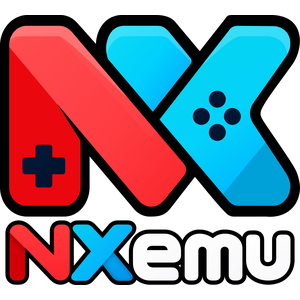

<div align="center">



<h1>NxEmu</h1>

<p><strong>A free and open-source Nintendo Switch emulator written in C++</strong></p>

<p>
  <a href="./license.txt"></a>
  <a href="https://github.com/N3xoX1/nxemu/releases"></a>
  <a href="https://github.com/N3xoX1/nxemu/stargazers"></a>
  <a href="https://github.com/N3xoX1/nxemu/commits"></a>
</p>

<p>
  <a href="https://www.nxemu.com"></a>
  <a href="https://discord.gg/hEa4hNyFWU"></a>
</p>

<p>
  <a href="https://www.nxemu.com">Website</a> &nbsp;|&nbsp;
  <a href="https://www.nxemu.com/downloads.html">Downloads</a> &nbsp;|&nbsp;
  <a href="https://www.nxemu.com/about.html">About</a> &nbsp;|&nbsp;
  <a href="https://discord.gg/hEa4hNyFWU">Discord</a>
</p>

</div>

---

## Table of Contents

- [Overview](#overview)
- [Platform Support](#platform-support)
- [Download](#download)
- [Building from Source](#building-from-source)
- [Contributing](#contributing)
- [Community](#community)
- [Legal Notice](#legal-notice)
- [License](#license)

## Overview

NxEmu is a Nintendo Switch emulator written in C++ and developed in the open. The project targets Windows today, with macOS, Android, and Linux ports under active development. NxEmu is licensed under the GNU General Public License v3.0, and contributions from the community are welcome.

## Platform Support

| Platform | Status         | Notes                                              |
|----------|----------------|----------------------------------------------------|
| Windows  | Supported      | Stable releases available on the downloads page    |
| macOS    | In development | May be incomplete or unstable                      |
| Android  | In development | May be incomplete or unstable                      |
| Linux    | In development | May be incomplete or unstable                      |

Builds for platforms marked "In development" are not yet recommended for general use.

## Download

Official stable releases for Windows are published on the [downloads page](https://www.nxemu.com/downloads.html). Release notes and previous versions are available under [GitHub Releases](https://github.com/N3xoX1/nxemu/releases).

## Building from Source

### Windows

**Requirements**

- Visual Studio with the "Desktop development with C++" workload
- Git

**Steps**

```bash
git clone --recursive https://github.com/N3xoX1/nxemu.git
cd nxemu
```

1. Open `nxemu.sln` in Visual Studio.
2. Select the **x64** configuration.
3. Build the solution.

If the repository was cloned without the `--recursive` flag, fetch the submodules with:

```bash
git submodule update --init --recursive
```

### macOS, Android, and Linux

Build instructions will be added as support for these platforms matures.

## Contributing

Contributions are welcome and appreciated.

1. Fork the repository and create a branch for your change.
2. Implement and test your changes.
3. Open a pull request describing what changed and why.

To report a bug or request a feature, please [open an issue](https://github.com/N3xoX1/nxemu/issues) and include clear steps to reproduce, along with your platform and build version. For questions and general discussion, join the community on [Discord](https://discord.gg/hEa4hNyFWU).

## Community

- [Website](https://www.nxemu.com)
- [About](https://www.nxemu.com/about.html)
- [Downloads](https://www.nxemu.com/downloads.html)
- [Discord](https://discord.gg/hEa4hNyFWU)

## Legal Notice

NxEmu is an independent project and is not affiliated with, endorsed by, or sponsored by Nintendo. "Nintendo Switch" is a trademark of Nintendo Co., Ltd.

NxEmu does not include or distribute copyrighted games, firmware, or encryption keys. Users are responsible for obtaining these legally from hardware they own.

## License

NxEmu is licensed under the [GNU General Public License v3.0](./license.txt).